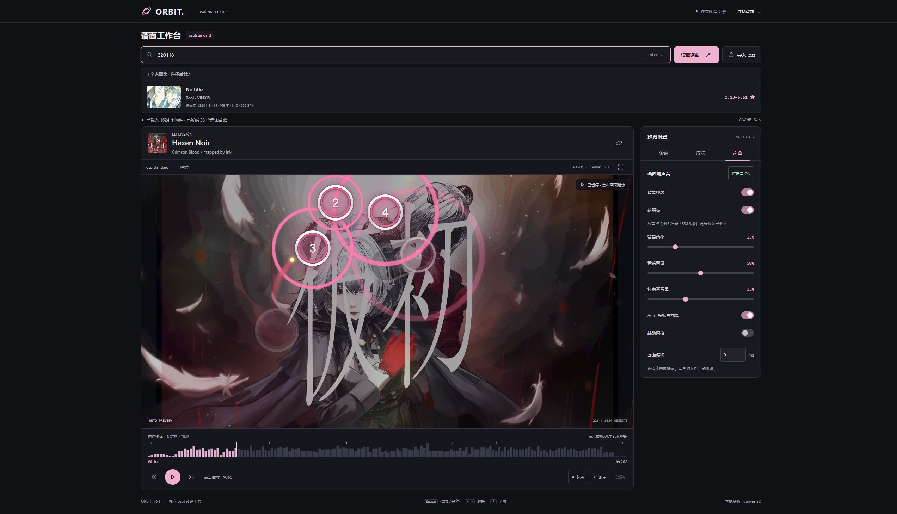
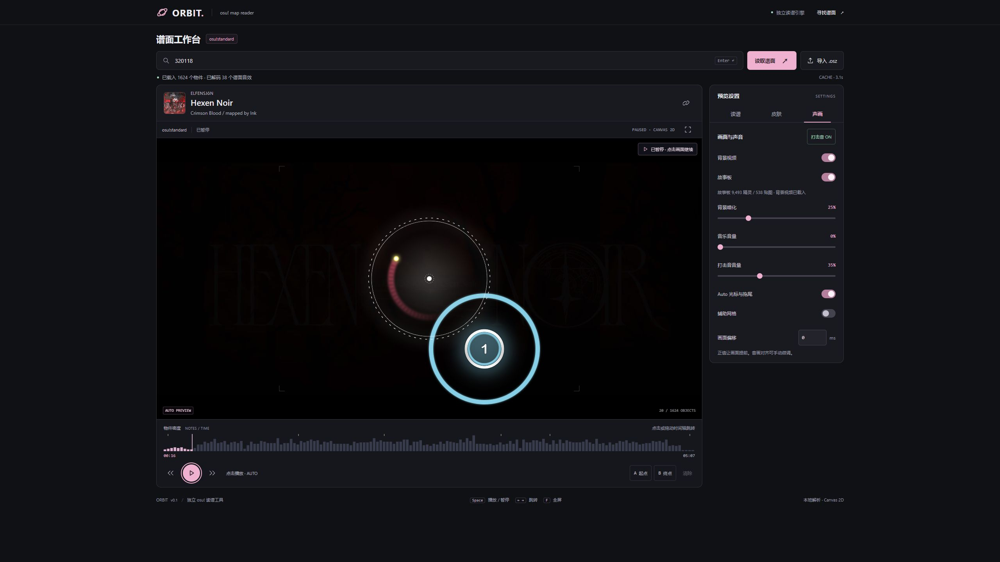
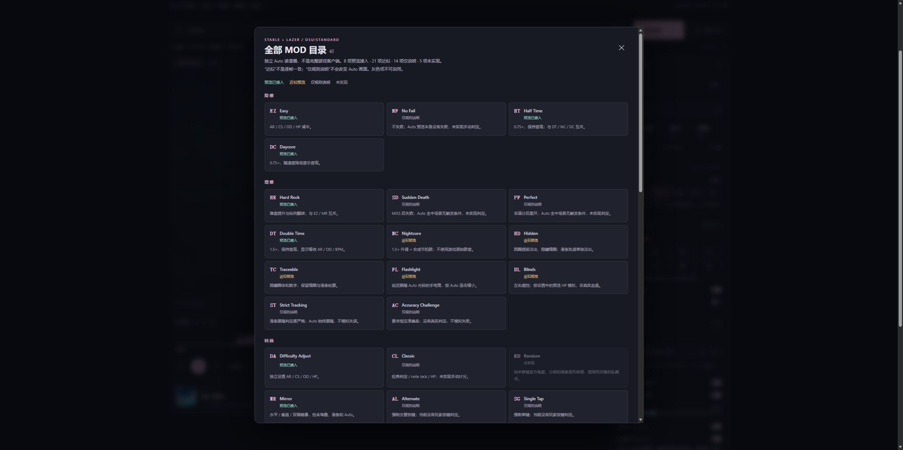

# ORBIT · osu! Map Reader

An independent, local-first **osu!standard full-map Auto preview**. Type a beatmap/difficulty-set ID to see matching cover cards, or import an `.osz` archive. This is a reading tool, not a gameplay/scoring simulator.

**Independent implementation:** parsing, slider geometry, stacking, Auto movement, rendering and audio scheduling live in this repository. No third-party osu! preview engine or Rust/WASM module is embedded. User-provided skins are local assets, not bundled/redistributed with the source. `fflate` handles ZIP archives; Vite/TypeScript/tsx are development tools.

[简体中文 (default)](README.md) · **English** · [Architecture and limitations](docs/ARCHITECTURE.md) · [Verification record](docs/VALIDATION.md)

The application UI is Chinese by default. This is a local-running preview, not a hosted public service.

## Screenshots







These are real browser captures, not mockups or benchmarks. [Third-party artwork and skin credits](docs/images/README.md). Third-party skin archives are not bundled; import your own authorized `.osk` or use the builtin vector look.

## Run locally

Requires Node.js **22.12+** (tested with **24.15.0**) and a current browser with Canvas 2D, Web Workers and Web Audio. WebGPU is not required.

```powershell
npm ci
npm run build
npm start
```

Open <http://127.0.0.1:4173>. On Windows, double-click **启动 ORBIT.cmd**. It checks dependencies/build output and starts a hidden local server; logs and its PID are kept under `.cache/`. It reuses an already running ORBIT instance. No Windows service/startup task is installed.

Development: `npm run dev`. Tests: `npm test`. Optional real-map geometry checks after an online download: `npx tsx scripts/validate-cache.ts`.

## Features

- Debounced ID / official URL lookup with covers, artist/mapper, difficulty counts, star ranges and timing metadata. One animated, single-column card per set; exact difficulty matches remain the load target. Selecting a card downloads the archive.
- Background video synchronized to the music clock, plus inline/shared OSB visual storyboards. See [media support and limits](docs/MEDIA.md).
- Browser-side `.osz` import and drag-and-drop, without an upload endpoint.
- Circles, L/B/P/C sliders, repeats, spinner visuals, combo colours and approximate stacking.
- Full-map Auto preview, seek/density timeline, editor bookmarks, A/B loops, fullscreen.
- Compact dark workspace with keyboard-accessible Reading / Skin / Audio & Visual tabs, responsive settings placement and collapsible slider options. Blinds HP appears only while BL is active.
- 0.5–2× practice speed plus stable/lazer MOD controls: 48 catalogued, 8 preview implementations, 21 approximate effects, 14 context-only and 5 explicitly unavailable. See [coverage matrix](docs/MODS.md).
- Music-master clock, optional custom samples and original synthesized fallback hitsounds.
- Local `.osk` gameplay skins: HD sprites, combo digits/colours, slider/cursor/spinner assets and optional skin hitsounds. Switch back to the original vector look at any time; see [skin coverage](docs/SKINS.md).
- Worker-side decompression/geometry; cached gradient slider textures, binary visibility lookup, unchanged paused-frame reuse.
- Local disk archive cache bounded to 512 MB; compressed archives limited to 128 MB.

## Resource/privacy boundaries

Search uses public Sayobot metadata (1-minute bounded memory cache); covers are requested from osu! assets. Selecting a result requests public `.osu` metadata from `osu.ppy.sh`, then downloads a **full-media** archive from Sayobot with Nerinyan fallback. Availability and mirror freshness are not guaranteed. The official metadata endpoint is still needed even when an archive is cached. Downloaded archives are retained locally in `.cache/beatmaps` (up to 512 MB); they contain music/images, not just metadata.

Local imports are parsed in browser memory and are not sent to the server. The server only binds `127.0.0.1`; copied preview links work only on the same machine. Do not expose this development-oriented server to the public internet. No credentials, OAuth account or API key are needed. Beatmap music/art remains owned by its respective creators; respect download restrictions and content rights.

Legacy files without embedded IDs additionally use Sayobot's public difficulty-to-set lookup. Their selected difficulty is verified against the official file's SHA-256, not guessed by title or filename.

## Not implemented / not guaranteed

Taiko/Catch/Mania, replay files, actual input judgement, score/PP/stars, full skin compatibility, conditional storyboard triggers/audio, unsupported browser video codecs, negative-time lead-in, perfect stable/lazer pixel/audio parity. Auto movement and Hidden rendering are approximations. AR/OD/BPM display real-time equivalents of the active rate; these are reading aids, not a full difficulty/star calculation. The renderer is readable rather than a game-client clone. No comparative performance benchmark has been established.

Frontend versions: TypeScript **7.0.2**, Vite **8.3.4**, fflate **0.8.3**, tsx **4.23.15**. Lockfile pins the installed dependency tree.

## Verification and license

Current local checkpoint: **65 tests** and the production build pass on Windows 10 / Edge. Actual Hexen Noir media verification covered 9,493 storyboard sprites, 538 referenced image assets and native MP4 playback/seek/pause. This is not complete-song, pixel-perfect, all-MOD or production-load certification. CI checks test/build on Windows and Linux; browser/media support requires separate acceptance.

Original project code: [MIT](LICENSE). Third-party dependencies retain their own licenses; screenshot artwork, music and skins remain the property of their creators. ORBIT is an independent community tool and is not affiliated with osu! / ppy.
